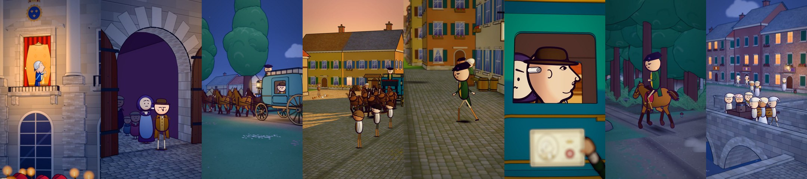
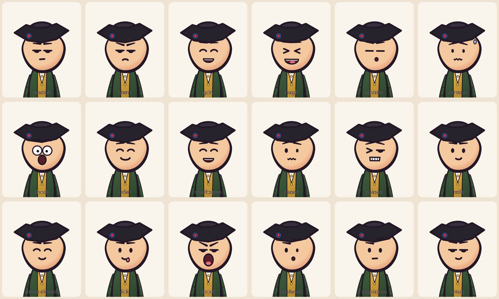

# short-anime-3d : des shorts animés 3D en français avec Claude



[](LICENSE)
[](SKILL.md)
[](https://www.remotion.dev/)
[](https://www.youtube.com/@Mist9-i3j)

Un skill Claude Code gratuit pour fabriquer des shorts verticaux animés de 50-70 s, en français, **sans aucun générateur vidéo IA** : Claude écrit le code, et le PC rend les images.

Les images ci-dessus viennent de « La fuite à Varennes », le short qui a servi à construire ce skill (53 s, 3 coupes, voix off enregistrée, pas de musique). Tout ce qu'il a fallu corriger pour y arriver est dedans.

**Le style.** Des personnages 2D, de type cartoon, dans un monde 3D coloré, avec :
- des contours à l'encre ;
- une ville peinte ;
- de la profondeur de champ ;
- des caméras qui glissent ;
- une voix off et des bruitages synthétisés.

**La fabrication.** Tout est rendu avec three.js dans Remotion, sur ton propre PC, sans générateur vidéo IA. Claude construit le monde, les personnages, la caméra et le son avec du code, image par image.

C'est la version française, enrichie, du skill [`cartoon-3d-short` de Mr omi](https://github.com/mromidev/claude-animated-shorts), sous licence MIT. Tout son contenu est traduit, et la production d'un short en français y a ajouté :
- **la voix off enregistrée par toi**, calée mot par mot ;
- **le mode sans musique et avec très peu de coupes** ;
- **le travail en parallèle** avec un agent par partie du film ;
- **la vérification image par image** à 3 relecteurs ;
- **le catalogue complet des bugs rencontrés et de leurs corrections**.

## Démarrage rapide

```bash
git clone https://github.com/Mist9989/short-anime-3d.git ~/.claude/skills/short-anime-3d
```

Puis, dans Claude Code : *« Utilise le skill short-anime-3d et fais un short sur la construction de la tour Eiffel, avec ma voix. »*

Les détails (outils à installer, dossier Windows, ordre des étapes) sont dans [Installation](#installation).

## Les deux exemples complets

| | Le pont (Mr omi) | La fuite à Varennes (ajouté) |
|---|---|---|
| Sujet | Le pont de Broughton (1831) s'effondre sous 74 soldats au pas | Louis XVI reconnu à Sainte-Menehould grâce à son portrait sur un assignat (juin 1791) |
| Durée | 67 s | 53 s |
| Voix | Anglaise, générée | **Française, enregistrée par l'auteur** |
| Musique | Marche originale synthétisée | Aucune : voix et bruitages |
| Montage | Coupes rythmées | 4 plans-séquences, 3 coupes |
| Lumières | jour, doré | nuit, aube, doré, nuit |

Les personnages ont 18 expressions, dessinées par le code (`templates/varennes/toon.ts`) :



## Ce que ce skill fait de plus que les autres

La plupart des tutoriels donnent un aperçu du résultat et quelques prompts. Ici, le skill contient **ce qui ne se voit pas dans la vidéo finale** :
- `references/varennes/CORRECTIONS.md` : les 53 défauts trouvés sur Varennes, classés par thème, avec leur cause et leur correction ;
- la méthode de **vérification image par image** à 3 relecteurs en parallèle, avec la consigne exacte à leur donner ;
- le **brief des agents** (`CONTEXTE_AGENTS.md`) : qui possède quel fichier quand plusieurs agents travaillent en même temps ;
- les **valeurs finales du look** (encre, flou, étalonnage, bloom par type de ciel), mesurées, pas estimées ;
- une **liste de 25 points** à vérifier avant de livrer.

## Ce qu'il y a dedans

| Chemin | Contenu |
|---|---|
| `SKILL.md` | Le skill : le pipeline complet, toutes les règles, les valeurs finales du look, les pièges |
| `templates/bridge/` | Le code complet du short du pont : monde, personnages, encre, flou d'objectif, étalonnage, histoire et caméra |
| `templates/varennes/` | Le code complet du short de Varennes : nuit et aube, chevaux et calèche, 18 expressions, flou de mouvement, corrections |
| `templates/audio/` | Le son du pont : bruitages, marche, mixage avec ducking et loudness |
| `templates/varennes_audio/` | Le son de Varennes : bruitages calés sur l'image (sabots, roues, pas), mixage sans musique |
| `templates/scripts/` | Les stills (dont la version avec verrou), les comparaisons côte à côte, la fusion des bacs à sable, la QA image par image, les temps des mots de la voix (`words.py`) |
| `templates/SCRIPT_example.md`, `templates/SCRIPT_exemple_varennes.txt` | Les deux scripts |
| `references/STYLE_BIBLE.md` | La formule de script et de visuel, mesurée sur 20 shorts de référence |
| `references/reports/` | 7 rapports mesurés : mouvement, profondeur, textures, personnages, lumière, contours, étalonnage |
| `references/frames/` | 38 images de référence en taille réelle (540x960) |
| `references/sheets/` | 20 planches contact, une par short de référence, 60 frames chacune |
| `references/varennes/` | Le plan des plans, le brief des agents, **le catalogue des corrections**, et 12 images du short final |

## Installation
1. **Copie ce dossier** dans le dossier des skills de Claude Code :
   - Windows : `%USERPROFILE%\.claude\skills\short-anime-3d\`
   - macOS et Linux : `~/.claude/skills/short-anime-3d/`

   Tu peux cloner le dépôt directement à cet endroit, ou télécharger le ZIP.
2. **Installe les outils.**
   - Un projet [Remotion](https://www.remotion.dev/) avec `@remotion/three`, `three`, `@react-three/fiber` et `@react-three/postprocessing`. Testé avec Remotion 4.0.540, three 0.170 et @react-three/fiber 8.
   - Node.js (testé avec la v24). `dump_story.mjs` demande Node ≥ 23.
   - Python 3 avec `numpy`, `Pillow` et `faster-whisper`. Ce dernier sert aux temps des mots de la voix.
   - ffmpeg, dans le PATH.
3. **Dans Claude Code**, dis par exemple : *« Utilise le skill short-anime-3d et fais un short sur … »*.

   Avec ta propre voix : donne le fichier audio et le texte exact du script.

Claude suit alors `SKILL.md`, dans cet ordre :
1. le sujet et les faits ;
2. le script ;
3. la voix et les temps des mots ;
4. le plan des plans dans `story.ts` ;
5. le monde et les personnages ;
6. des images fixes de contrôle, comparées aux références ;
7. le son ;
8. la vérification image par image ;
9. le rendu final en 2K (1440x2560).

## Notes pratiques
- **Disque.** Règle `REMOTION_TMP` (ou `TEMP` et `TMP`) sur un dossier d'un gros disque : chaque bundle Remotion copie `public/` dans le dossier temporaire et ne le supprime jamais.
- **Petite machine.** Sur un PC à GPU intégré et 16 Go de RAM, fais un seul rendu à la fois (`templates/scripts/stills.mjs` pose un verrou) et pas de fondu enchaîné.
- **Export 2K.** `--scale 1.3333333333333333` (avec `1.3333`, le rendu échoue).
- **Langue du code.** Les commentaires du code sont en anglais. Les noms de fichiers, fonctions et constantes sont ceux du code.
- **Fichiers `cues.md`.** Ils sont traduits, mais `mix.py` les réécrit en anglais si tu relances le mixage.
- **Ton contenu.** L'histoire, les personnages et la voix doivent toujours être les tiens. Les références servent pour le look, pas pour le contenu.


Le code et les documents sont sous licence MIT (voir `LICENSE`) : © 2026 Mr omi pour le skill d'origine, © 2026 Mist9989 pour l'adaptation française et les ajouts de Varennes. Si tu redistribues ce skill, garde le fichier `LICENSE`.

Les images de référence (`references/frames/` et `references/sheets/`) sont incluses uniquement pour l'étude du style, comme dans le skill d'origine.
